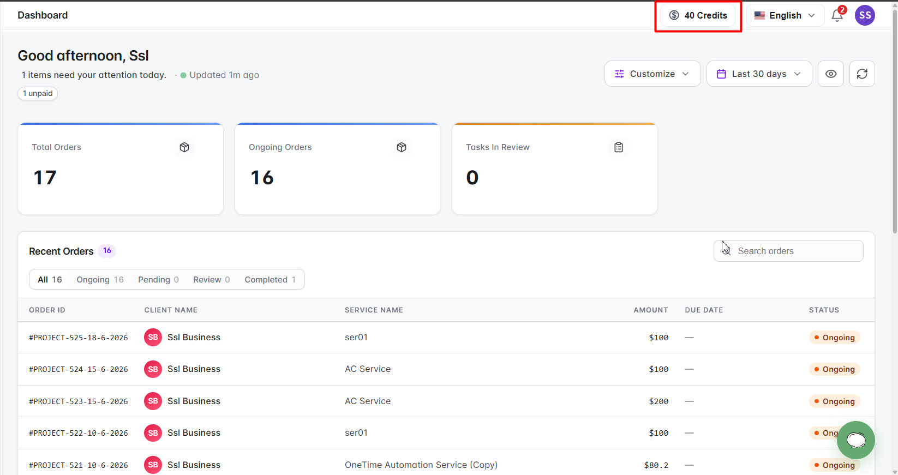
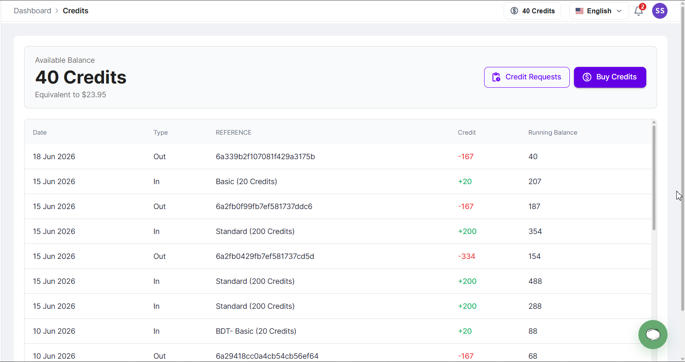
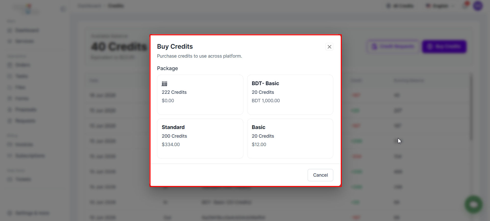
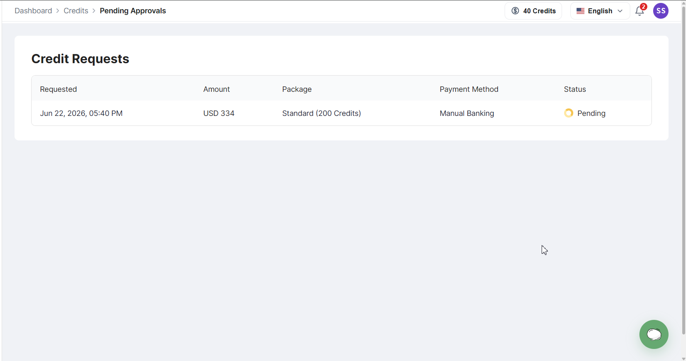
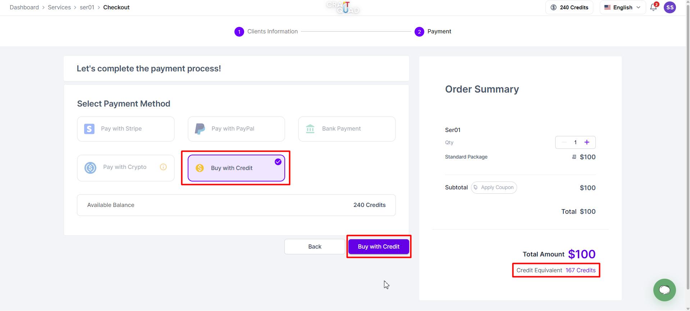
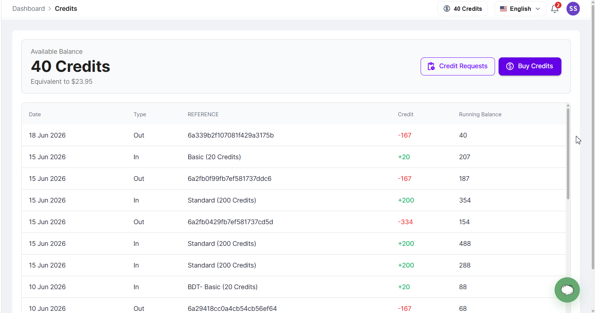

Kredit memungkinkan Anda membeli layanan dan membayar faktur menggunakan saldo prabayar, alih-alih melakukan pembayaran terpisah setiap kali. Anda dapat membeli kredit, memantau saldo yang tersedia, melihat riwayat transaksi, dan menggunakan kredit di seluruh platform setiap kali agensi mengaktifkan pembayaran kredit.

## Cara kerja kredit

Kredit dibeli di muka dan ditambahkan ke saldo akun Anda.

Saat Anda membeli layanan atau membayar faktur menggunakan kredit:

- Kredit yang diperlukan dipotong secara otomatis.
- Saldo Anda langsung diperbarui.
- Transaksi dicatat dalam riwayat kredit Anda.

<Note>
  Jika agensi menonaktifkan pembayaran kredit, fitur terkait kredit tidak akan tersedia.
</Note>

## Melihat saldo kredit Anda

Saat agensi mengaktifkan pembayaran kredit, saldo kredit Anda yang tersedia ditampilkan di bilah navigasi atas.

*Widget saldo kredit yang ditampilkan di header portal klien*

### Membuka halaman Credits

Klik widget saldo kredit untuk membuka halaman Credits.

Halaman Credits menyediakan:

- Saldo kredit yang tersedia
- Riwayat transaksi
- Saldo berjalan
- Permintaan kredit
- Opsi **Buy Credits**

*Halaman dasbor Credits*

## Membeli kredit

Anda dapat membeli kredit tambahan kapan saja menggunakan tombol **Buy Credits**.

<Steps>
  <Step title="Buka halaman Credits">
    Klik widget saldo kredit di bilah navigasi atas.
  </Step>
  <Step title="Klik Buy Credits">
    Pilih tombol **Buy Credits**.
  </Step>
  <Step title="Pilih paket">
    Pilih paket kredit dari opsi yang tersedia.
  </Step>
  <Step title="Pilih metode pembayaran">
    Pilih metode pembayaran yang Anda inginkan.
  </Step>
  <Step title="Selesaikan pembayaran">
    Ikuti proses pembayaran untuk menyelesaikan pembelian.
  </Step>
</Steps>

*Halaman Buy Credits yang menampilkan paket kredit yang tersedia*

## Metode pembelian kredit

Setiap metode pembayaran memproses kredit dengan cara yang berbeda.

### Pembelian kredit instan

Kredit ditambahkan secara otomatis setelah pembayaran berhasil saat menggunakan:

- Stripe
- PayPal

Setelah pembayaran dikonfirmasi, kredit langsung ditambahkan, saldo Anda diperbarui, dan transaksi dicatat dalam riwayat kredit Anda.

### Pembelian kredit manual

Kredit yang dibeli melalui Transfer Bank atau Kripto memerlukan persetujuan agensi sebelum ditambahkan ke akun Anda.

Setelah mengirim pembayaran:

1. Permintaan kredit dibuat.
2. Permintaan dikirim ke agensi untuk ditinjau.
3. Kredit baru ditambahkan setelah agensi menyetujuinya.

## Permintaan kredit

Permintaan kredit memungkinkan Anda memantau pembelian yang memerlukan persetujuan agensi.

<Steps>
  <Step title="Buka halaman Credits">
    Klik widget saldo kredit di bilah navigasi atas.
  </Step>
  <Step title="Lihat Credit Requests">
    Klik **Credit Requests** untuk melihat status permintaan Anda yang tertunda maupun sebelumnya.
  </Step>
</Steps>

*Halaman Credit Requests*

**Status permintaan:**

- **Tertunda**: permintaan Anda sudah dikirim dan menunggu peninjauan agensi.
- **Diterima**: permintaan telah disetujui dan kredit sudah ditambahkan ke saldo Anda.
- **Ditolak**: permintaan ditolak dan tidak ada kredit yang ditambahkan.

## Membayar layanan dengan kredit

Saat pembayaran kredit diaktifkan dan kredit Anda mencukupi, Anda dapat membeli layanan menggunakan saldo kredit.

<Steps>
  <Step title="Buka layanan">
    Buka layanan yang ingin Anda beli.
  </Step>
  <Step title="Lanjutkan ke checkout">
    Mulai proses checkout untuk layanan tersebut.
  </Step>
  <Step title="Pilih Buy with Credit">
    Pilih opsi **Buy with Credit**.
  </Step>
  <Step title="Selesaikan pembelian">
    Konfirmasi untuk menyelesaikan pembelian.
  </Step>
</Steps>

*Halaman checkout layanan yang menampilkan opsi Buy with Credit*

Setelah pembelian selesai, kredit dipotong secara otomatis, saldo Anda langsung diperbarui, dan transaksi muncul di riwayat kredit Anda.

**Saat Buy with Credit tidak tersedia:**

Opsi **Buy with Credit** tidak akan muncul jika:
- Agensi telah menonaktifkan pembayaran kredit.
- Kredit Anda tidak cukup.
- Layanan tidak dapat dibayar dengan kredit.

## Membayar faktur dengan kredit

Anda juga dapat menggunakan kredit untuk membayar faktur yang belum dibayar.

<Steps>
  <Step title="Buka faktur">
    Buka faktur yang ingin Anda bayar.
  </Step>
  <Step title="Klik Pay Invoice">
    Pilih tombol **Pay Invoice**.
  </Step>
  <Step title="Pilih Pay with Credit">
    Pilih opsi **Pay with Credit**.
  </Step>
  <Step title="Konfirmasi pembayaran">
    Konfirmasi untuk menyelesaikan pembayaran.
  </Step>
</Steps>

*Halaman pembayaran faktur yang menampilkan opsi Pay with Credit*

Setelah pembayaran selesai, kredit dipotong secara otomatis, faktur ditandai lunas, saldo Anda diperbarui, dan transaksi muncul di riwayat kredit Anda.

**Saat Pay with Credit tidak tersedia:**

Opsi **Pay with Credit** tidak akan muncul jika:
- Agensi telah menonaktifkan pembayaran kredit.
- Kredit Anda tidak mencukupi.
- Jumlah faktur melebihi saldo yang tersedia.

## Memahami riwayat kredit Anda

Semua aktivitas kredit dicatat di halaman Credits Anda.

Setiap transaksi mencakup:

- Tanggal
- Jenis transaksi
- Referensi
- Jumlah kredit
- Saldo berjalan

*Tabel riwayat transaksi kredit*

**Jenis transaksi:**

- **In**: kredit yang ditambahkan ke akun Anda (pembelian paket kredit, permintaan kredit yang disetujui).
- **Out**: kredit yang dipotong dari akun Anda (pembelian layanan, pembayaran faktur).

## Kredit yang ditambahkan atau dikurangi oleh agensi Anda

Agensi Anda juga dapat menambahkan kredit ke saldo Anda atau menguranginya, misalnya untuk pekerjaan yang dilakukan berdasarkan perjanjian per jam, dan dapat menambahkan kredit secara otomatis setiap bulan. Perubahan ini muncul di riwayat kredit Anda dengan referensi:

- **Ditambahkan oleh** *nama* atau **Dikurangi oleh** *nama*: anggota agensi mengubah saldo Anda.
- **Kredit bulanan**: kredit yang ditambahkan oleh jadwal bulanan yang diatur agensi Anda.

Jika perubahan dibuat dalam jam, baris tersebut menampilkan jam dan tarifnya (misalnya “2 h × 120/h”). Catatan dari agensi, seperti “3 jam pemasaran, Oktober”, ditampilkan di baris yang sama.

Kredit tidak pernah kedaluwarsa. Kredit tetap ada di saldo Anda sampai Anda menggunakannya atau agensi Anda menguranginya.

## Pertanyaan yang Sering Diajukan

<AccordionGroup>
  <Accordion title="Mengapa saya tidak melihat widget Credits?">
    Agensi telah menonaktifkan pembayaran kredit untuk workspace ini.
  </Accordion>

  <Accordion title="Mengapa saya tidak dapat membeli kredit?">
    Agensi mungkin telah menonaktifkan pembayaran kredit.
  </Accordion>

  <Accordion title="Mengapa saya tidak melihat opsi Buy with Credit?">
    Agensi mungkin telah menonaktifkan pembayaran kredit, kredit Anda mungkin tidak cukup, atau layanan tersebut tidak mendukung pembayaran kredit.
  </Accordion>

  <Accordion title="Mengapa saya tidak melihat opsi Pay with Credit pada faktur?">
    Agensi mungkin telah menonaktifkan pembayaran kredit atau saldo kredit Anda tidak mencukupi.
  </Accordion>

  <Accordion title="Kapan kredit ditambahkan ke akun saya?">
    Kredit yang dibeli melalui Stripe dan PayPal langsung ditambahkan setelah pembayaran berhasil. Kredit yang dibeli melalui Transfer Bank atau Kripto ditambahkan setelah disetujui agensi.
  </Accordion>

  <Accordion title="Dapatkah saya melihat semua transaksi kredit saya?">
    Ya. Semua pembelian dan pemotongan kredit tersedia di halaman Credits.
  </Accordion>

  <Accordion title="Apa arti jenis transaksi In dan Out?">
    **In** berarti kredit yang ditambahkan ke akun Anda.

    **Out** berarti kredit yang dipotong dari akun Anda.
  </Accordion>

  <Accordion title="Apa yang terjadi jika permintaan kredit saya ditolak?">
    Tidak ada kredit yang ditambahkan ke saldo Anda. Anda dapat menghubungi agensi untuk informasi lebih lanjut tentang permintaan tersebut.
  </Accordion>

  <Accordion title="Dapatkah saya menggunakan kredit untuk layanan dan faktur?">
    Ya. Kredit dapat digunakan untuk membeli layanan dan membayar faktur setiap kali pembayaran kredit diaktifkan dan kredit Anda mencukupi.
  </Accordion>

  <Accordion title="Apakah kredit saya bisa kedaluwarsa?">
    Tidak. Kredit tetap ada di saldo Anda sampai Anda menggunakannya atau agensi Anda menguranginya.
  </Accordion>
</AccordionGroup>
