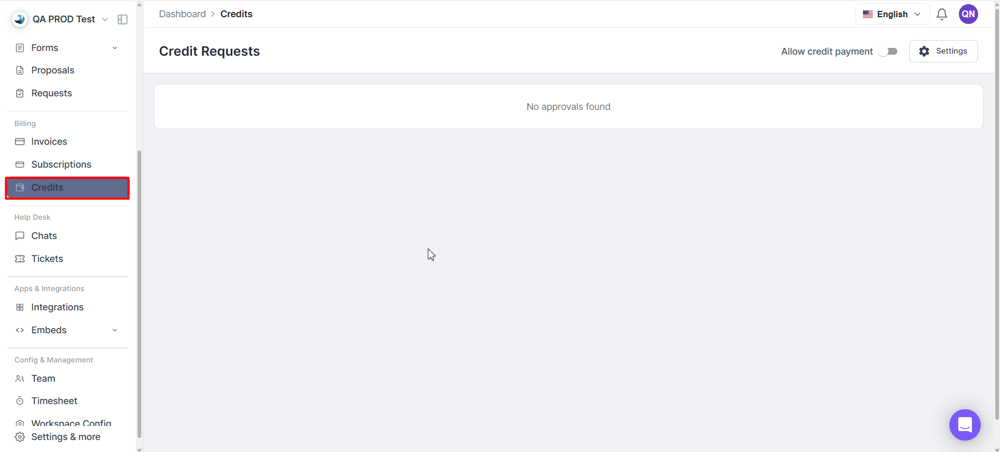
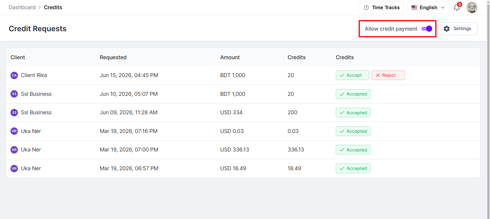
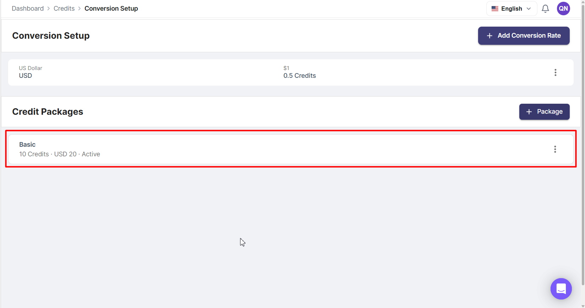
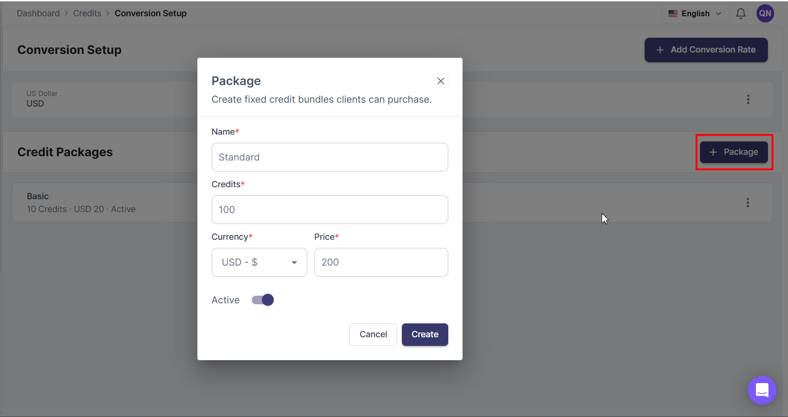
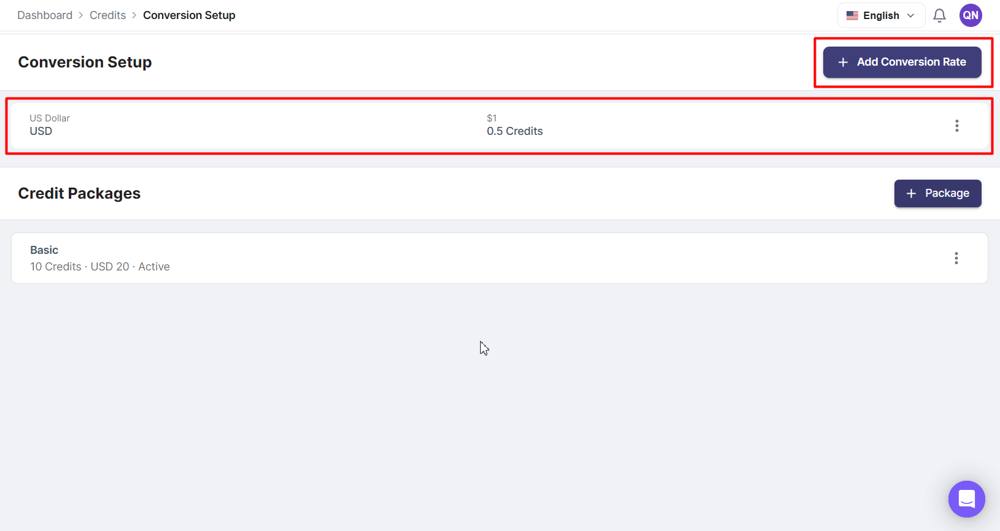
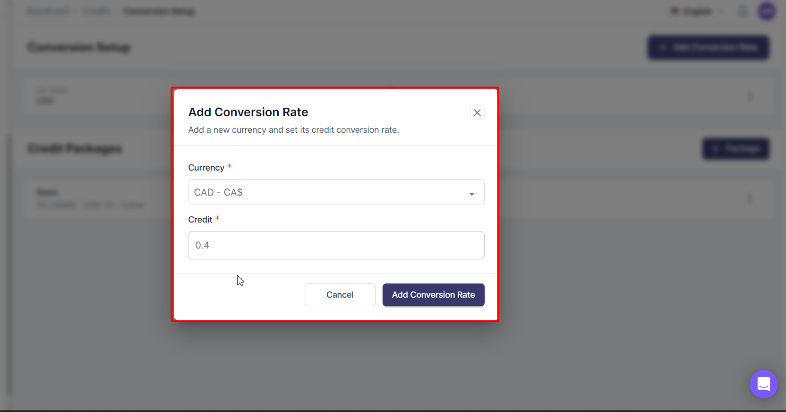
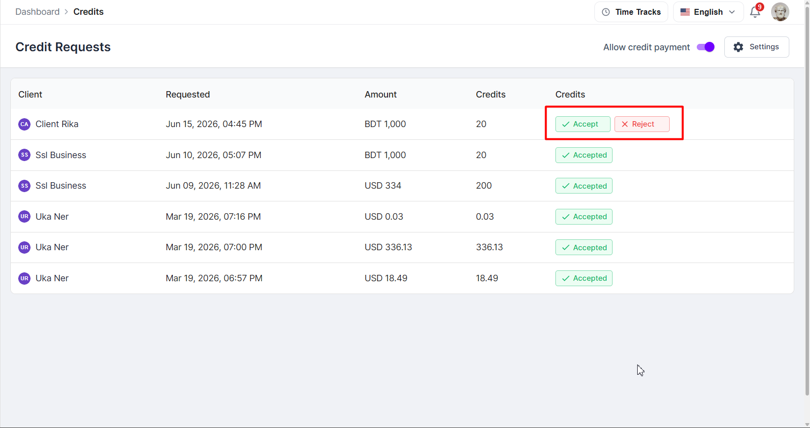
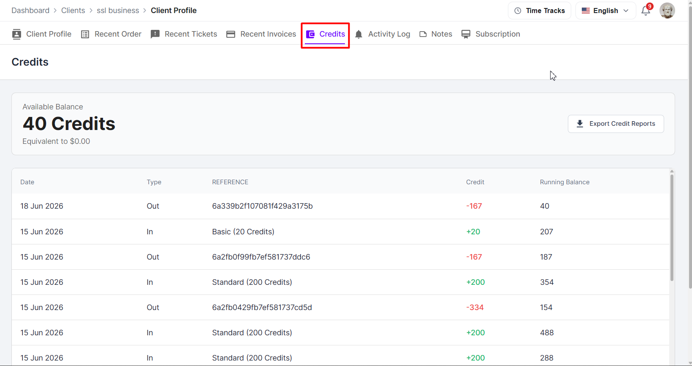

Credits enable you to offer services through a prepaid system. You create credit packages with a price, set conversion rates that define how many credits one unit of currency buys, and clients purchase credits in advance. When a client orders a service or pays an invoice, AgencyHandy converts the price into credits, deducts the required amount, and records every transaction in a complete audit trail.

## How credits work

The credit system has three components:

- **Credit packages**: bundles of credits that clients purchase (for example, 500 credits for $50).
- **Conversion rates**: rules that convert a service's currency price into credits (for example, 1 USD = 10 credits).
- **Credit balance**: the credits available to a client to spend on services or invoices.

**Example:** A service costs $3.51 and the conversion rate is 1 USD = 10 credits.

`$3.51 × 10 = 35.1 credits → rounded up to 36 credits`

AgencyHandy always rounds up to the nearest whole credit.

*Credit Page*

## Enable credit payments

Before clients can purchase or use credits, you must turn the feature on.

<Steps>
  <Step title="Navigate to Credits">
    In the left sidebar, go to **Credits**.
  </Step>
  <Step title="Turn on the toggle">
    Enable the **Allow Credit Payment** toggle.
  </Step>
</Steps>

*Toggle to turn on credit payment*

**When enabled**, clients can:
- See their credit balance widget in the client portal.
- Access the Credits page and purchase packages.
- Submit credit requests.
- Use **Buy with Credit** during service checkout.
- Use **Pay with Credit** on invoices.

**When disabled**, the credit widget and all credit options are hidden from the client portal. Existing credit balances are preserved, and clients can still use other payment methods.

## Create credit packages

Credit packages are what clients purchase to load credits onto their account.

<Steps>
  <Step title="Open Credit Packages settings">
    Navigate to **Credits → Settings → Credit Packages**.
  </Step>
  <Step title="Add a package">
    Click **+ Package**.
  </Step>
  <Step title="Fill in the details">
    Enter a package name, the number of credits included, the currency, and the price.
  </Step>
  <Step title="Save">
    Click **Create**.
  </Step>
</Steps>

*Credit Package List View*

*Create Credit Package*

## Manage conversion rates

Conversion rates determine how many credits are required for a service based on its currency price. You can set a different rate per currency.

<Steps>
  <Step title="Open Conversion Rates settings">
    Navigate to **Credits → Settings → Conversion Rates**.
  </Step>
  <Step title="Add a rate">
    Click **+ Add Conversion Rate**.
  </Step>
  <Step title="Configure the rate">
    Select a currency and enter the number of credits equivalent to one unit of that currency.
  </Step>
  <Step title="Save">
    Click **Save**.
  </Step>
</Steps>

*Conversion List Page*

*Add Conversion Rate Form*

**Example rates:**

| Currency | Rate |
|----------|------|
| USD | 1 USD = 10 credits |
| EUR | 1 EUR = 9 credits |
| GBP | 1 GBP = 12 credits |

<Note>
  Only one active conversion rate can exist per currency at any given time.
</Note>

## Automatic vs manual credit purchases

How credits are added to a client's account depends on the payment method used.

**Automatic** (no approval needed):
- Stripe
- PayPal

Credits are added immediately after a successful payment.

**Manual** (requires agency approval):
- Bank Transfer
- Cryptocurrency

When a client pays via a manual method, a credit request is created. You must review and approve it before credits are added.

## Manage credit requests

<Steps>
  <Step title="Open credit requests">
    Navigate to **Billing → Credits**.
  </Step>
  <Step title="Locate pending requests">
    Review the client name, payment amount, and number of credits requested.
  </Step>
  <Step title="Approve or reject">
    Click **Accept** to add the credits, or **Reject** to decline.
  </Step>
</Steps>

*Credit Requests*

**Request statuses:**

- **Pending**: submitted and awaiting review.
- **Accepted**: approved; credits have been added to the client's balance.
- **Rejected**: declined; no credits were added.

## View client credits

<Steps>
  <Step title="Open the client profile">
    Navigate to **Clients** and click on a client's name.
  </Step>
  <Step title="Go to the Credits tab">
    Select the **Credits** tab.
  </Step>
</Steps>

*Viewing Client Credit*

The Credits tab shows the client's available balance, full transaction history, running balance, and transaction references.

## Add or deduct credits

Admins and super admins can add credits to a client's balance or deduct credits from it, free of charge. Use it to give a bonus, record work done under a barter agreement, or correct a balance.

<Steps>
  <Step title="Open the client's Credits tab">
    Navigate to **Clients**, click the client's name, and select the **Credits** tab.
  </Step>
  <Step title="Click Adjust credits">
    Next to the balance, click **Adjust credits**.
  </Step>
  <Step title="Choose Add credits or Deduct credits">
    When you deduct, the dialog shows the client's current balance.
  </Step>
  <Step title="Enter the amount">
    Under **Unit**, choose **Credits** to enter a whole number of credits, or **Hours** to enter hours (up to 2 decimals) and **Credits per hour**. In Hours mode the converted amount shows as you type, for example 2 hours × 120 credits per hour = 240 credits.
  </Step>
  <Step title="Add a note (optional)">
    Enter up to 280 characters, for example "3 hours of marketing, October". The note appears in the credit history.
  </Step>
  <Step title="Confirm">
    Click **Add credits** or **Deduct credits**.
  </Step>
</Steps>

<Note>
  The credits-per-hour rate is remembered for each client and pre-filled the next time you choose **Hours**.
</Note>

<Warning>
  A deduction can never take the balance below zero. If the amount is more than the current balance, the dialog shows **This is more than the current balance** and the deduction is not saved ("Not enough credits").
</Warning>

## Give credits every month

**Monthly credits** add credits to a client automatically on the same day every month, which suits retainers and barter agreements. Only admins and super admins can set them up.

<Steps>
  <Step title="Open Monthly credits">
    On the client's **Credits** tab, click **Monthly credits** next to the balance.
  </Step>
  <Step title="Set the amount and day">
    Enter the **Credits per month** and the **Day of month** (1–28).
  </Step>
  <Step title="Choose how credits are given">
    Pick one of the two modes in **How credits are given** (see the table below).
  </Step>
  <Step title="Add a note (optional)">
    The note is shown on every monthly credit row in the credit history.
  </Step>
  <Step title="Turn it on and save">
    Make sure the schedule is turned on (**Active**), then click **Save**.
  </Step>
</Steps>

| Mode | What happens each month |
|------|-------------------------|
| **Add this amount every month** | The amount is added to the balance. Unused credits roll over. |
| **Top up to this amount every month** | The balance is brought back up to the amount. Unused credits don't roll over, and nothing is added if the balance is already at or above it. |

Once saved, the Credits tab shows the schedule (for example "Monthly: 360 credits on day 1"), the next run date, and the last grant.

- Credits are added automatically. You don't need to do anything each month.
- If a scheduled month is missed, its credits are added once when the schedule runs again, never more than once.
- No credits are added while the workspace or the client is inactive.
- To stop, open **Monthly credits**, turn the schedule off, and click **Save**. Future grants stop; credits already added stay on the balance.

### Example: a monthly barter agreement

You agree to trade 3 hours of work every month at 120 credits per hour.

1. Set **Monthly credits** to 360 credits per month on day 1 with **Top up to this amount every month**. Choose **Add this amount every month** instead if unused hours should carry over.
2. As you do the work, click **Adjust credits**, choose **Deduct credits** and **Hours**, and enter the time spent, for example 1.5 hours at 120 credits per hour (180 credits), with a note such as "Homepage copy, November".
3. The client sees each deduction, with the hours and your note, on their Credits page.

<Note>
  Credits never expire. Credits you add, buy, or grant monthly stay on the balance until they are spent or deducted.
</Note>

## Ask Handy

You can also ask **Handy**, the in-app assistant, for example *"Deduct 2 hours of marketing from Elizabeth at 120 credits an hour"*, *"Give Acme 360 credits every month on the 1st"* or *"How many credits does Acme have left?"*. Handy shows you exactly what it will do and waits for approval before it adds or deducts credits or sets monthly credits. Only a **Super Admin** or **Admin** can approve.

## Understand credit transactions

Every credit activity is recorded in the client's transaction history.

**In**: credits added to the account:
- Credit package purchase
- Approved credit request

**Out**: credits deducted from the account:
- Service purchased using credits
- Invoice paid using credits

Each transaction shows the date, type, reference, credit amount, and running balance, providing a complete audit trail.

**Credits you add or deduct by hand, and monthly credits**, appear in the same history with a reference that shows where they came from:

- **Added by** *name* or **Deducted by** *name*: a team member used **Adjust credits**.
- **Monthly credits**: added by the monthly schedule.

When the amount was entered in hours, the row also shows the hours and rate (for example "2 h × 120/h"), followed by your note. Clients see these rows, including the note, on their Credits page, and exports of the credit history include the note.

## Frequently Asked Questions

<AccordionGroup>
  <Accordion title="Can clients purchase credits when credit payments are disabled?">
    No. Clients cannot purchase credits while the **Allow Credit Payment** toggle is disabled.
  </Accordion>

  <Accordion title="What happens to existing balances when credit payments are disabled?">
    Existing balances remain unchanged. Clients simply cannot access or use the Credits feature until it is enabled again.
  </Accordion>

  <Accordion title="Are Stripe and PayPal purchases approved automatically?">
    Yes. Credits purchased through Stripe and PayPal are added automatically after successful payment.
  </Accordion>

  <Accordion title="Do Bank Transfer and Cryptocurrency purchases require approval?">
    Yes. These payment methods create a credit request that must be reviewed and approved by the agency.
  </Accordion>

  <Accordion title="Can agencies reject a credit request?">
    Yes. Agencies can approve or reject any pending credit request.
  </Accordion>

  <Accordion title="Can agencies view a client's complete credit history?">
    Yes. Agencies can review a client's balance and transaction history from the **Credits** tab within the client profile.
  </Accordion>

  <Accordion title="What do In and Out transaction types mean?">
    **In** indicates credits added to the client's account.

    **Out** indicates credits deducted from the client's account.
  </Accordion>

  <Accordion title="Why don't clients see the Buy with Credit option?">
    The agency may have disabled credit payments, or the client may not have sufficient credits available.
  </Accordion>

  <Accordion title="Why don't clients see the Pay with Credit option on invoices?">
    The agency may have disabled credit payments, or the client may not have sufficient credits available to cover the invoice amount.
  </Accordion>

  <Accordion title="Can I give a client credits without a payment?">
    Yes. Admins and super admins can use **Adjust credits** on the client's **Credits** tab to add or deduct credits free of charge, or set up **Monthly credits** to add them automatically every month.
  </Accordion>

  <Accordion title="Can a deduction make a balance negative?">
    No. You can't deduct more credits than the client currently has.
  </Accordion>

  <Accordion title="Do credits expire?">
    No. Credits stay on the balance until they are spent or deducted.
  </Accordion>
</AccordionGroup>
