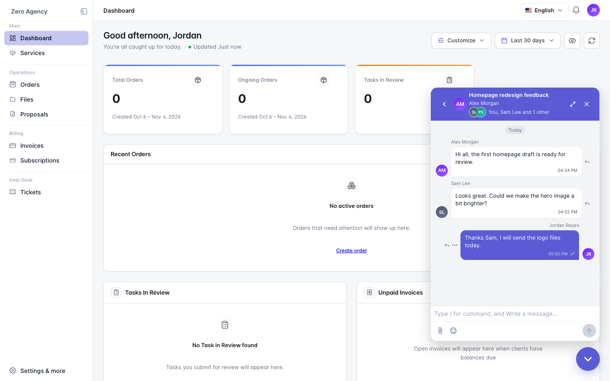

채팅을 사용하여 에이전시와 실시간으로 메시지를 주고받으세요. 에이전시는 동료 등 여러분 쪽 사람들을 대화에 추가할 수 있어, 모두가 같은 스레드에서 소통할 수 있습니다.

## 대화 열기

포털 오른쪽 아래의 채팅 버튼을 클릭한 다음 대화를 엽니다.

## 스레드 참여자 확인

채팅 헤더에는 여러분 쪽에서 대화에 참여한 다른 사람이 표시됩니다. 예: **나, Sam Lee 외 1명**. 여러분 쪽 다른 사람이 보낸 메시지에는 그 사람의 이름과 아바타가 표시됩니다.

## 포털이나 이메일로 답장하기

새 메시지는 모두 이메일로도 받습니다. 답장 방법은 두 가지입니다.

- 포털 채팅에서 답장합니다.
- 이메일에 답장합니다. 답장은 여러분의 이름으로 같은 대화에 표시됩니다.

이메일 답장은 에이전시에 등록된 주소에서 보내세요. 다른 주소에서 보낸 답장은 대화에 추가되지 않습니다.

## 알아 두면 좋은 점

- 여러분이 참여한 대화만 볼 수 있습니다.
- 스레드의 다른 사람은 여러분의 이메일 주소를 볼 수 없으며, 여러분도 다른 사람의 주소를 볼 수 없습니다.
- 사람을 추가하거나 제거할 수 있는 것은 에이전시뿐입니다. 대화에서 제거되면 즉시 접근 권한을 잃습니다.
- 여러분 쪽 모든 사람이 하나의 읽지 않은 메시지 수를 공유합니다. 동료가 읽은 메시지는 여러분에게도 더 이상 읽지 않음으로 표시되지 않을 수 있습니다.

<Tip>
  상태와 함께 추적하고 싶은 요청은 티켓을 여세요. [지원 받기](/ko/client/support-tickets)를 참고하세요.
</Tip>
