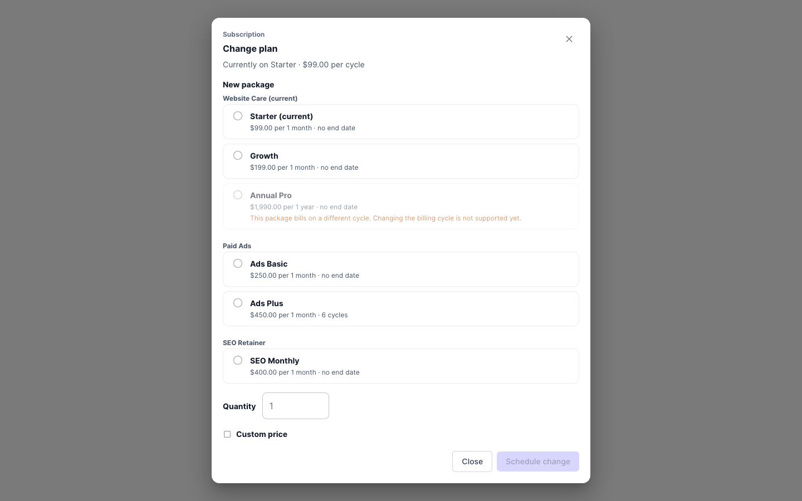
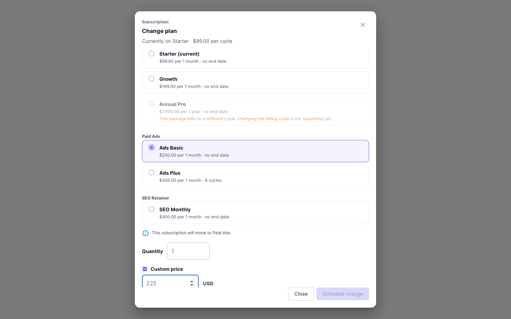
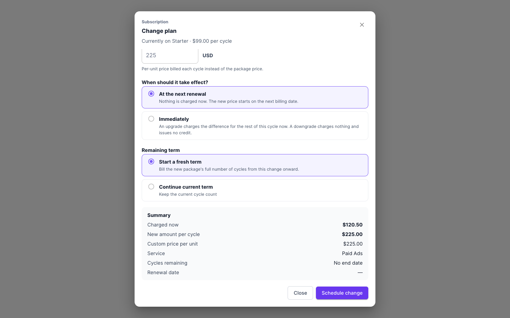

AgencyHandy:s prenumerationsfaktureringssystem låter dig automatisera hela arbetsflödet för återkommande intäkter. När en klient prenumererar på en tjänst skapar plattformen ett prenumerations-ID, genererar beställningar och utfärdar fakturor automatiskt vid varje faktureringsperiod — oavsett om det är dagligen, veckovis, månadsvis eller årsvis. Du behåller kontrollen: du kan visa prenumerationsuppgifter, övervaka betalningshistorik, hantera misslyckade betalningar och avboka prenumerationer vid behov, allt från AgencyHandy.

## Hur prenumerationsfakturering fungerar

Prenumerationens livscykel i AgencyHandy följer sex nyckelsteg.

<Steps>
  <Step title="Skapa en prenumerationsbaserad tjänst">
    Navigera till **Tjänster** och klicka på **Skapa ny tjänst**. Välj **Prenumeration** som tjänsttyp.

    Definiera:
    - **Faktureringsperiod** — Dagligen, Veckovis, Månadsvis eller Årsvis
    - **Förnyelsesbeteende** — Skapa ny beställning, Uppdatera befintlig beställning eller Behåll oförändrat
    - **Prissättning och betalningsmetod** — PayPal, Stripe eller Manuell

    Klicka på **Publicera** för att göra tjänsten tillgänglig.
  </Step>
  <Step title="Klienten köper prenumerationen">
    Klienten väljer prenumerationstjänsten, går till kassan och väljer en betalningsmetod.

    AgencyHandy skapar automatiskt:
    - Ett **Prenumerations-ID**
    - En **Beställning**
    - En **Faktura**

    För **PayPal eller Stripe**-betalningar markeras fakturan som **Betald** omedelbart. För **Manuell betalning** förblir fakturan **Öppen** tills byrån bekräftar mottagandet.
  </Step>
  <Step title="Automatiserad återkommande fakturering">
    Vid varje förnyelsedatum behandlar AgencyHandy betalningen automatiskt (för PayPal/Stripe) och genererar nästa faktura.

    Om betalningen lyckas markeras fakturan som **Betald**. Om den misslyckas:
    - Fakturan förblir **Öppen**
    - Klienten får ett **meddelande om misslyckad betalning**
    - Byrån får ett varningsmeddelande om att försöka igen eller begära uppdaterade betalningsuppgifter
  </Step>
  <Step title="Hantera aktiva prenumerationer">
    Navigera till **Prenumerationshantering** i den vänstra sidopanelen för att se alla aktiva och inaktiva prenumerationer. Välj valfri prenumeration för att se dess fullständiga uppgifter.
  </Step>
  <Step title="Hantera avbokningar">
    När du avbokar en prenumeration kan du välja att:
    - **Avboka helt** — stoppa all framtida fakturering och beställningar
    - **Håll den senaste aktiva beställningen igång** — låt klienten fortsätta ta emot tjänsten fram till den aktuella periodens deadline

    För att ta bort en tjänst helt måste alla aktiva prenumerationer på den tjänsten avbokas först.
  </Step>
  <Step title="Meddelanden">
    Systemet skickar automatiskt:
    - **Förnyelsepåminnelser** innan nästa faktureringsdatum
    - **Betalningsbekräftelser** efter framgångsrika debiteringar
    - **Varningar om misslyckad betalning** till både klienten och byråns administratörer
  </Step>
</Steps>

## Sidan för prenumerationsuppgifter

Sidan för prenumerationsuppgifter ger dig en fullständig bild av varje enskild prenumeration — från tjänsten och paketet ner till varje faktura och händelseloggpost.

### Hur man öppnar

1. Gå till **Prenumerationer** i den vänstra sidopanelen
2. Klicka på valfri prenumeration i listan för att öppna dess detaljsida

### Vad du kan se

<Tabs>
  <Tab title="Prenumerationsinformation">
    - **Tjänstnamn** och **Paketnamn**
    - **Klientnamn**
    - **Faktureringsperiod** (t.ex. Månadsvis, Årsvis)
    - **Startdatum** och **Slutdatum**
    - Prenumerationens **Status** (Aktiv eller Inaktiv)
  </Tab>
  <Tab title="Betalningsuppgifter">
    - **Prenumerationsavgift**
    - **Totalt antal betalningar** gjorda hittills
    - **Betalningsmetod** (Stripe, PayPal, Wise, Manuell banking, etc.)
    - **Nästa betalningsdatum**
  </Tab>
  <Tab title="Beställningshistorik">
    - **Beställnings-ID**
    - **Status** (t.ex. Pågående, Slutförd)
    - **Startdatum** och **Förfallodatum** för varje beställning
  </Tab>
  <Tab title="Fakturahistorik">
    - **Faktura-ID**
    - **Belopp**
    - **Status** (Öppen, Betald, etc.)
    - **Betalningsdatum** och **Förfallodatum**
  </Tab>
  <Tab title="Händelseloggar">
    En kronologisk revisionslogg över alla aktiviteter relaterade till prenumerationen — statusändringar, betalningshändelser, avbokningar och mer.
  </Tab>
</Tabs>

<Note>
  En enskild prenumeration kan ha flera kopplade beställningar och fakturor. Fakturor kopplade till prenumerationer uppdateras dynamiskt när betalningar tas emot.
</Note>

## Byt plan

Använd **Change plan** för att flytta en aktiv prenumeration till ett annat paket, en annan kvantitet eller ett annat pris. Planbyten är bara tillgängliga för Stripe-prenumerationer.

<Steps>
  <Step title="Öppna dialogrutan">
    Öppna prenumerationens detaljsida och klicka på **Change plan**.
  </Step>
  <Step title="Välj det nya paketet">
    Välj ett paket under **New package** och ange **Quantity**. Paketen är grupperade per tjänst, och det nuvarande är markerat med **(current)**.
  </Step>
  <Step title="Välj när ändringen gäller">
    Under **When should it take effect?** väljer du:
    - **Immediately** – vid en uppgradering debiteras den proportionella skillnaden för resten av den aktuella perioden direkt. En nedgradering kostar ingenting och ger ingen kredit.
    - **At the next renewal** – ingenting debiteras nu. Det nya priset gäller från nästa faktureringsdatum.

    Om paketet har ett fast antal perioder väljer du också hur **Remaining term** räknas.
  </Step>
  <Step title="Kontrollera sammanfattningen och tillämpa">
    Granska **Summary** och klicka sedan på **Change plan now** eller **Schedule change**.
  </Step>
</Steps>

En schemalagd ändring visas som ett meddelande högst upp i dialogrutan, med det nya paketet, datumet och tjänsten och det anpassade priset när de ändras. Klicka på **Cancel change** för att ångra den före förnyelsen.

### Byt till en annan tjänst

Du kan flytta en prenumeration till ett paket i en annan tjänst i samma workspace. Den andra tjänstens paket måste ha samma valuta och faktureringsperiod som den nuvarande prenumerationen. Paket som inte matchar visas men kan inte väljas.

När du väljer ett paket från en annan tjänst visar dialogrutan **Den här prenumerationen flyttas till** och tjänstens namn.

Efter ändringen:

- Prenumerationen och dess framtida beställningar tillhör den nya tjänsten.
- Befintliga uppgifter finns kvar som de är. Den nya tjänstens standarduppgifter läggs inte till.

### Ange ett anpassat pris

Markera **Anpassat pris** för att fakturera ditt eget pris per enhet i stället för paketpriset. Du kan ange upp till 2 decimaler, eller heltal för valutor utan decimaler som JPY.

Stripe debiterar det anpassade priset. Senare förnyelser behåller det tills du byter plan igen utan anpassat pris. **Summary** visar **Anpassat pris per enhet** och **Tjänst**.

### Begränsningar

- Planbyten fungerar bara för Stripe-prenumerationer.
- Det går inte att byta faktureringsperiod. Du kan till exempel inte flytta en månadsprenumeration till ett årspaket.
- En prenumeration innehåller ett paket. Använd [tillägg för tjänster](/sv/services/create-service) för att fakturera flera poster på en prenumeration.

## Wise-stöd för manuella prenumerationsfakturor

Om du tar emot internationella betalningar kan du bädda in en **Wise-betalningslänk** direkt i prenumerationsfakturor. Detta ger klienter ett bekvämt sätt att betala utan att behöva ange en banköverföring manuellt.

### Krav

- Ett aktivt AgencyHandy-konto
- Ett aktivt **Wise-konto** med en giltig betalningslänk genererad

### Steg för att lägga till en Wise-länk i en faktura

<Steps>
  <Step title="Öppna fakturaavsnitt">
    Klicka på **Fakturor** i den vänstra sidopanelen och klicka sedan på **+ Skapa faktura**.
  </Step>
  <Step title="Välj klient och beställning">
    Välj klienten från rullgardinsmenyn. Alla relaterade beställnings-ID:n visas. Välj det relevanta beställnings-ID:t och ange beloppet och eventuella poster som faktureras.
  </Step>
  <Step title="Tillämpa rabatter och skatter">
    Lägg till eventuell tillämplig rabattprocent, rabattbelopp, betalt belopp, förfallet belopp och moms/skatteuppgifter. Inkludera faktureringsadress och anteckningar efter behov.
  </Step>
  <Step title="Lägg till Wise-betalningslänken">
    I avsnittet **Betalningsmetod** väljer du **Wise** som betalningsalternativ. Klistra in din Wise-betalningslänk i det tillhandahållna fältet.
  </Step>
  <Step title="Spara fakturan">
    Klicka på **Spara** för att slutföra fakturan. Wise-betalningslänken visas i fakturan så att klienten kan betala direkt.
  </Step>
</Steps>

<Tip>
  Dubbelkontrollera alltid din Wise-betalningslänk och fakturatotaler innan du sparar. Verifiera att beställningsuppgifter, rabatter och skatteinformation är korrekta för att undvika faktureringsfel.
</Tip>

## Viktiga anteckningar om prenumerationsfakturering

<Accordion title="Vem kan avboka prenumerationer?">
  Endast **Super Admins** och **Admins** kan avboka prenumerationer. Klienter kan inte avboka sina egna prenumerationer — de måste begära avbokning via byrån.
</Accordion>

<Accordion title="Prenumerations-ID:n är permanenta">
  När en prenumeration har skapats kan dess prenumerations-ID inte redigeras. Detta säkerställer konsekvent spårning under hela prenumerationens livstid.
</Accordion>

<Accordion title="Misslyckade betalningar och beställningsskapande">
  När en betalning misslyckas förblir fakturan Öppen och en ny beställning skapas för den misslyckade perioden. Prenumerationsstatusen förblir **Aktiv** tills en administratör manuellt försöker igen med betalningen eller avbokar prenumerationen.
</Accordion>

<Accordion title="Manuella betalningsbeställningar">
  Om en klient betalar utanför Stripe eller PayPal (t.ex. via banköverföring) måste administratören manuellt markera fakturan som **Betald** i AgencyHandy. Systemet gör inte detta automatiskt för manuella betalningar.
</Accordion>

<Accordion title="Obetalda självbetjäningsförsök">
  Om en klient startar en prenumerationskassa men inte slutför betalningen förblir de i systemet som ett **lead** tills de framgångsrikt prenumererar.
</Accordion>

<Accordion title="Fakturans förfallodatum">
  Förfallodatum för prenumerationsfakturor ställs in automatiskt baserat på den faktureringsperiod du konfigurerade (t.ex. är månatliga fakturor förfallna en månad efter startdatumet).
</Accordion>
