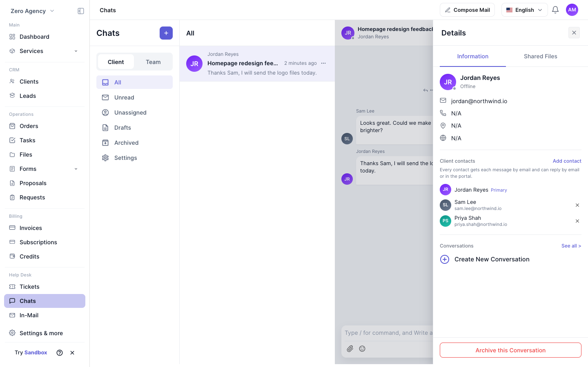
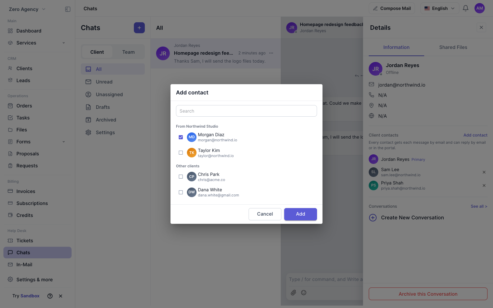

**對話** 是您和團隊與客戶即時溝通的地方。一個客戶對話從一位客戶開始，也就是主要客戶。您可以加入客戶方的更多人員，例如同事或主管，讓所有人在同一個對話中協作。

從左側邊欄的 **服務台** 區段開啟 **對話**。

## 客戶聯絡人

開啟一個客戶對話及其 **詳細資訊** 面板。**客戶聯絡人** 區段會列出對話中客戶方的所有人員：

- 主要客戶，標示為 **主要**。
- 您加入的每位聯絡人及其電子郵件地址。

### 新增聯絡人

<Steps>
  <Step title="開啟對話框">
    在 **客戶聯絡人** 中，點擊 **新增聯絡人**。
  </Step>
  <Step title="尋找要加入的人員">
    依姓名或電子郵件搜尋。清單會先顯示與主要客戶同一公司的人員，歸在 **來自** 加公司名稱的群組下。接著是工作區中的其他客戶，歸在 **其他客戶** 下。已在對話中的人員不會顯示。
  </Step>
  <Step title="加入人員">
    選取一位或多位人員，然後點擊 **新增**。
  </Step>
</Steps>

### 移除聯絡人

點擊聯絡人旁的 **×** 並確認。該聯絡人會立即失去此對話的存取權。主要客戶無法被移除。

### 限制

- 每個對話最多可有 20 位聯絡人。
- 聯絡人必須已是同一工作區中的客戶。若要加入新的人員，請先在 **客戶** 中將其建立為客戶。

## 誰可以管理聯絡人

| 角色 | 能否新增與移除聯絡人 |
|---|---|
| 工作區管理員 | 可以 |
| 被指派到該對話的團隊成員 | 可以 |
| 其他團隊成員 | 不可以 |
| 客戶 | 不可以 |

## 聯絡人如何參與

- **電子郵件通知。** 每位聯絡人都會透過電子郵件收到每則新訊息。
- **透過電子郵件或入口網站回覆。** 聯絡人可以直接回覆郵件，或在客戶入口網站中開啟對話。電子郵件回覆會以該聯絡人的身分出現在同一個對話中。
- **忽略未知寄件者。** 來自不在對話中的電子郵件地址的回覆不會被張貼。
- **共用未讀數。** 對話中客戶方的所有人員共用同一個未讀數。

## 隱私

- 客戶只能看到自己參與的對話。將某人加入一個對話，並不會讓對方存取該客戶的其他對話。
- 客戶之間看不到彼此的電子郵件地址。在入口網站中，其他聯絡人只會顯示姓名與頭像。

<Tip>
  若要了解聯絡人在入口網站中看到的內容，請閱讀[與代理商對話](/zh-Hant/client/chat)。
</Tip>
